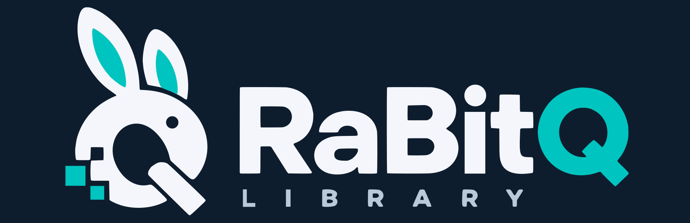

<div align="center">

<p></p>

<p>
  <a href="https://pypi.org/project/rabitqlib/"></a>
  <a href="https://pypi.org/project/rabitqlib/"></a>
  <a href="https://vectordb-ntu.github.io/RaBitQ-Library/"></a>
  <a href="LICENSE"></a>
</p>

</div>

RaBitQ-Library is a research-backed library for vector quantization and
approximate nearest-neighbor search. See the [research papers](docs/docs/papers.md).

## News

- **v0.7.0:** Modular C++ components, stable core API v1, optional
  OpenMP for numerical components, and unified index counts. This documentation
  targets 0.7.0; see the [upgrade notes](docs/docs/releases/0.7.0.md).

## Vector indexes

Use the included indexes when you want construction, search, and save/load in one
library. All three support L2 and inner product; normalize vectors for cosine
search. Their structures, storage costs, and search parameters offer different
QPS–recall tradeoffs.

| Index | Search approach | Storage and updates |
| --- | --- | --- |
| [IVF-RaBitQ](docs/docs/index/ivf.md) | Partitioned search with batch scoring. | 1–9-bit codes or raw-vector reranking; add/remove. |
| [HNSW-RaBitQ](docs/docs/index/hnsw.md) | Graph traversal over quantized vectors. | 1–9-bit codes plus graph edges; add/remove and resize. |
| [SymphonyQG](docs/docs/index/qg.md) | Graph search with batched distance estimation. | Raw or 4/8-bit storage; updates require rebuilding. |

[Native clustering methods](docs/docs/clustering.md) prepare centroids and
assignments for IVF-RaBitQ and HNSW-RaBitQ.

See the [benchmarks](docs/docs/benchmarks/bench.md) for measured results,
settings, and limitations.

## Quick start

### Python

```bash
python -m pip install --upgrade "rabitqlib>=0.7.1"
```

Wheels support CPython 3.11–3.14 on Linux x86-64/ARM64, Windows x86-64,
and macOS 14+ ARM64. x86-64 requires AVX2/FMA and optionally uses
AVX-512; ARM64 uses NEON. See [platform requirements and source installation](docs/docs/installation.md#requirements).

Build and search a small IVF-RaBitQ index with synthetic data; no dataset download is
required. This example demonstrates the API, not performance.

```python
import numpy as np
from rabitqlib import FinalAssignmentMode, IvfIndex, RaBitQKMeans

rng = np.random.default_rng(42)
data = rng.standard_normal((500, 64)).astype(np.float32)
queries = rng.standard_normal((5, 64)).astype(np.float32)

clustering = RaBitQKMeans(
    64, 5, num_threads=2, final_assignment=FinalAssignmentMode.Exact
)
clustering.train(data)
index = IvfIndex(dim=64, max_elements=len(data), num_clusters=5, nbits=4, metric="l2")
index.build(data, clustering.centroids, clustering.assignments)
ids, distances = index.search(queries, k=10, nprobe=5)
print(ids.shape, distances.shape)  # (5, 10) (5, 10)
```

IDs identify input rows; distances here estimate squared L2 distance, with smaller
values first. Quantization remains approximate even when all clusters are probed.
The [complete quick start](docs/docs/quick_start.md) explains result handling,
measures recall while varying `nprobe`, and shows save/load.

For other indexes, see the [HNSW-RaBitQ](docs/docs/index/hnsw.md#minimal-workflow) and
[SymphonyQG](docs/docs/index/qg.md#minimal-workflow) examples.

### C++

Use the [C++ integration guide](docs/docs/cpp_integration.md) for source builds,
component linking, and installation. Start with the
[C++ index examples](docs/docs/cpp_integration.md#c-examples), or use the
quantization components below in your own engine.

## Quantization components

Integrate encoding and distance estimation into your own storage and search
engine, independently of the included indexes.

| Component | What it provides | Start here |
| --- | --- | --- |
| `rabitqlib::core` | Rotation, per-vector encoding, query preparation, and distance estimation. | [Core example](sample/cpp/core/) · [Stable v1 API](docs/docs/rabitq/core_api.md) |
| `rabitqlib::fastscan` | Batch encoding and lookup-table scoring over 32-vector layouts, built on core. | [FastScan example](sample/cpp/fastscan/) |

See [component integration](docs/docs/cpp_integration.md#core-only-c-integration)
for build options and compatibility, the [quantizer guide](docs/docs/rabitq/quantizer.md)
for encoding choices, and the [core benchmark](benchmarks/core/README.md) for
component throughput and estimation error.

## Adoption and resources

### Built with RaBitQ-Library

Two examples of direct library integration:

| Project | Integration |
| --- | --- |
| [txtai](docs/docs/integrations/txtai.md) | Uses the Python IVF-RaBitQ and HNSW-RaBitQ indexes as an embedding-search backend. |
| [zvec](docs/docs/integrations/zvec.md) | Uses core quantization in its own IVF-RaBitQ and HNSW-RaBitQ indexes, with FastScan batch scoring in IVF-RaBitQ. |

The linked walkthroughs describe integration boundaries and provide versioned
source references.

### RaBitQ across the vector-search ecosystem

The projects below illustrate adoption of RaBitQ techniques across vector search.
They do not necessarily depend on RaBitQ-Library; direct library integrations are
listed above.

<table>
  <tr>
    <td align="center" width="16%">
      <a href="https://github.com/milvus-io/milvus"><br>Milvus</a>
    </td>
    <td align="center" width="16%">
      <a href="https://github.com/facebookresearch/faiss"><br>Faiss</a>
    </td>
    <td align="center" width="16%">
      <a href="https://github.com/NVIDIA/cuvs"><br>NVIDIA cuVS</a>
    </td>
    <td align="center" width="16%">
      <a href="https://github.com/microsoft/DiskANN/blob/main/diskann-quantization/src/lib.rs"><br>Microsoft DiskANN</a>
    </td>
    <td align="center" width="16%">
      <a href="https://github.com/antgroup/vsag"><br>VSAG</a>
    </td>
    <td align="center" width="16%">
      <a href="https://github.com/tensorchord/VectorChord"><br>VectorChord</a>
    </td>
  </tr>
  <tr>
    <td align="center" width="16%">
      <a href="https://www.volcengine.com/docs/6465/1553583"><br>Volcengine OpenSearch</a>
    </td>
    <td align="center" width="16%">
      <a href="https://github.com/cockroachdb/cockroach"><br>CockroachDB</a>
    </td>
    <td align="center" width="16%">
      <a href="https://github.com/elastic/elasticsearch"><br>Elasticsearch</a>
    </td>
    <td align="center" width="16%">
      <a href="https://github.com/apache/lucene"><br>Apache Lucene</a>
    </td>
    <td align="center" width="16%">
      <a href="https://turbopuffer.com/blog/ann-v3#:~:text=ANN%20v3%20employs%20the%20RaBitQ"><br>turbopuffer</a>
    </td>
    <td align="center" width="16%">
      <a href="https://github.com/alibaba/zvec"><br>Zvec</a>
    </td>
  </tr>
  <tr>
    <td align="center" width="16%">
      <a href="https://docs.lancedb.com/indexing/quantization#rabitq-quantization"><br>LanceDB</a>
    </td>
    <td align="center" width="16%">
      <a href="https://docs.databricks.com/aws/en/oltp/projects/lakebase-vector"><br>Databricks</a>
    </td>
    <td align="center" width="16%">
      <a href="https://clickhouse.com/docs/engines/table-engines/mergetree-family/annindexes#quantized-codecs-methods"><br>ClickHouse</a>
    </td>
    <td align="center" width="16%">
      <a href="https://qdrant.tech/articles/turboquant-quantization/#1-bit-rabitq-bit-plane-scoring"><br>Qdrant</a>
    </td>
    <td align="center" width="16%">
      <a href="https://docs.weaviate.io/weaviate/concepts/vector-quantization#rotational-quantization"><br>Weaviate</a>
    </td>
  </tr>
</table>

### Further reading

- [Documentation](https://vectordb-ntu.github.io/RaBitQ-Library/) and [algorithm overview](docs/docs/rabitq/rabitq.md).
- [Papers and citations](docs/docs/papers.md) for the research behind the library.
- [Release notes](https://github.com/VectorDB-NTU/RaBitQ-Library/releases) and [0.7 migration guide](docs/docs/modular_migration.md).
- [GPU implementation](https://github.com/Stardust-SJF/cuvs_rabitq/tree/cuvs_ivf_rabitq) in cuVS.

## Contributing

Start with the [contribution guide](.github/CONTRIBUTING.md#your-first-contribution)
or [starter tasks](.github/CONTRIBUTING.md#starter-tasks). Report bugs and request
features through [GitHub Issues](https://github.com/VectorDB-NTU/RaBitQ-Library/issues/new/choose).
See [maintenance and feedback](.github/CONTRIBUTING.md#feedback-and-further-reading) for maintainer information.

## Acknowledgements

RaBitQ Library is developed by Yutong Gou, Jianyang Gao, Yuexuan Xu, Jifan Shi,
and Zhonghao Yang. We thank Alexandr Guzhva, Li Liu, Chao Gao, Silu Huang,
Jiabao Jin, Xiaoyao Zhong, and Jinjing Zhou for their valuable feedback.

## License

RaBitQ Library is available under the [Apache License 2.0](LICENSE).
