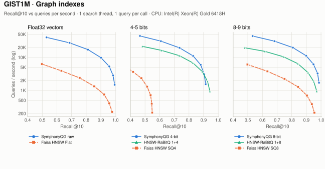
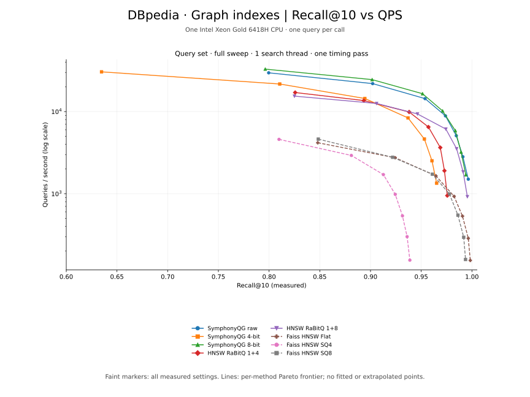

# Graph benchmark

RaBitQ-Library results were measured with **0.8.0 on 2026-11-01 (Asia/Singapore)**.
Each baseline retains its latest measurement and was not rerun.
See the [source revisions, environments and comparison limits](bench.md#package-installation).

Settings and results for eight configurations. See the [overview](bench.md) for
hardware, datasets, and measurement definitions.

## Reading the results

Each figure groups methods with similar storage per dimension into panels;
method names are defined under [index configurations](#index-configurations).
Curves use one search thread and one query per call over all 1,000 queries.
Indexes are built with 48 threads and reused for the query sweeps.
See [figure definitions](bench.md#reading-the-figures) and
[indexing metrics](bench.md#reading-the-indexing-tables).

## GIST1M

{ .chart }

### Indexing time and size

<!-- indexing:gist1m:start -->
| Method | Train s | Construct s | Total s | Save s | Index GiB |
| --- | ---: | ---: | ---: | ---: | ---: |
| SymphonyQG raw | 0.00 | 35.67 | 35.67 | 3.23 | 7.51 |
| SymphonyQG 4-bit | 0.00 | 31.45 | 31.45 | 1.79 | 4.39 |
| SymphonyQG 8-bit | 0.00 | 33.30 | 33.30 | 2.01 | 4.84 |
| HNSW-RaBitQ 1+4 | 1.33 | 70.72 | 72.05 | 0.33 | 0.72 |
| HNSW-RaBitQ 1+8 | 1.46 | 74.19 | 75.64 | 0.55 | 1.16 |
| Faiss HNSW Flat | 0.00 | 78.94 | 78.94 | 1.61 | 3.71 |
| Faiss HNSW SQ4 | 1.06 | 55.11 | 56.17 | 0.24 | 0.58 |
| Faiss HNSW SQ8 | 1.08 | 47.12 | 48.20 | 0.42 | 1.03 |
<!-- indexing:gist1m:end -->

## DBpedia

{ .chart }

### Indexing time and size

<!-- indexing:dbpedia:start -->
| Method | Train s | Construct s | Total s | Save s | Index GiB |
| --- | ---: | ---: | ---: | ---: | ---: |
| SymphonyQG raw | 0.00 | 57.30 | 57.30 | 5.27 | 11.79 |
| SymphonyQG 4-bit | 0.00 | 51.70 | 51.70 | 2.79 | 6.80 |
| SymphonyQG 8-bit | 0.00 | 52.69 | 52.69 | 3.24 | 7.51 |
| HNSW-RaBitQ 1+4 | 1.49 | 112.24 | 113.73 | 0.52 | 1.05 |
| HNSW-RaBitQ 1+8 | 1.58 | 124.77 | 126.35 | 0.80 | 1.76 |
| Faiss HNSW Flat | 0.00 | 147.53 | 147.53 | 2.69 | 5.85 |
| Faiss HNSW SQ4 | 1.74 | 101.82 | 103.57 | 0.36 | 0.85 |
| Faiss HNSW SQ8 | 1.79 | 80.66 | 82.45 | 0.64 | 1.56 |
<!-- indexing:dbpedia:end -->

## Index configurations

SymphonyQG uses maximum degree 32, `ef_construction=200`, `init="pipnn"`, and one
refinement iteration. Both HNSW implementations use `M=16` and
`efConstruction=200`, giving a base-layer degree bound of 32.

| Method | Stored representation | Additional construction settings |
| --- | --- | --- |
| SymphonyQG raw | `quantization_bits=0`, raw vectors | Degree 32, PIPNN initialization |
| SymphonyQG 4-bit | `quantization_bits=4` | Degree 32, PIPNN initialization |
| SymphonyQG 8-bit | `quantization_bits=8` | Degree 32, PIPNN initialization |
| HNSW-RaBitQ 1+4 | `nbits=5` | `M=16`, seed 42, 16 residual centroids |
| HNSW-RaBitQ 1+8 | `nbits=9` | `M=16`, seed 42, 16 residual centroids |
| Faiss HNSW Flat | `HNSW16` | Float32 vectors |
| Faiss HNSW SQ4 | `HNSW16_SQ4` | Four-bit scalar quantization |
| Faiss HNSW SQ8 | `HNSW16_SQ8` | Eight-bit scalar quantization |

HNSW-RaBitQ trains 16 centroids with RaBitQKMeans (up to 10 iterations, seed 42,
exact final assignment, spherical training for DBpedia's inner-product metric).
Training is reported separately and included in total construction time.
SymphonyQG 4/8-bit and HNSW-RaBitQ 1+4/1+8 use different encodings; serialized
sizes include their full storage costs.

All graph methods sweep `ef=16,32,64,128,256,512,1024` (Faiss calls this
`efSearch`).

## Download measurements

[QPS–recall CSV](figures/qps-recall-points.csv) · [Indexing CSV](figures/indexing.csv)
