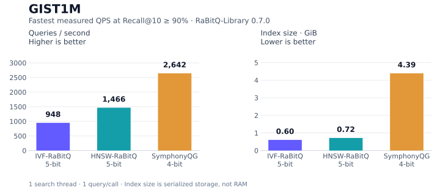

RaBitQ Library · C++17 &amp; Python

# Compact vectors. Accurate search. { #compact-vector-search-with-rabitq }

A C++17 and Python library for vector search,
from compact quantization to complete indexes.

[Get started with Python](quick_start.md){ .md-button .md-button--primary }
[Use C++ &rarr;](cpp_integration.md)

## Start here

  

    <h3><a href="quick_start/">Python quick start &rarr;</a></h3>
    
Install the package, build an IVF index, search it, and save it.

  

  

    <h3><a href="cpp_integration/">C++ integration &rarr;</a></h3>
    
Choose core, FastScan, or index components for your application.

  

  

    <h3><a href="rabitq/rabitq/">How RaBitQ works &rarr;</a></h3>
    
Understand rotation, compact codes, and distance estimation.

  

## Choose your index

Explore search throughput, recall, and storage for three quantized configurations.

<!-- homepage-results:start -->

**GIST1M**

1,000,000 vectors · 960 dimensions · L2

<!-- homepage-results:end -->

QPS uses the fastest measured setting reaching **Recall@10 ≥ 90%**;
actual recall and storage budgets differ.
[Detailed results, settings, and measurement conditions](benchmarks/bench.md#homepage-selection).

## Built with RaBitQ-Library

- [txtai](integrations/txtai.md) uses the Python IVF and HNSW indexes as an
  embedding-search backend. See how to select the backend and its search settings.
- [zvec](integrations/zvec.md) uses core quantization in its IVF-RaBitQ and
  HNSW-RaBitQ implementations, with FastScan batch scoring in IVF. See the
  integration walkthrough for storage, scoring, and platform boundaries.

These are direct library integrations, with versioned downstream source links.

## Explore further

- [Algorithm overview](rabitq/rabitq.md) for the rotation, encoding, and scoring workflow.
- [RaBitQ Library 0.7.0 release notes](releases/0.7.0.md) for new APIs and upgrade guidance.
- [Papers and citations](papers.md) for the original RaBitQ method, its multi-bit extension, and SymphonyQG.
